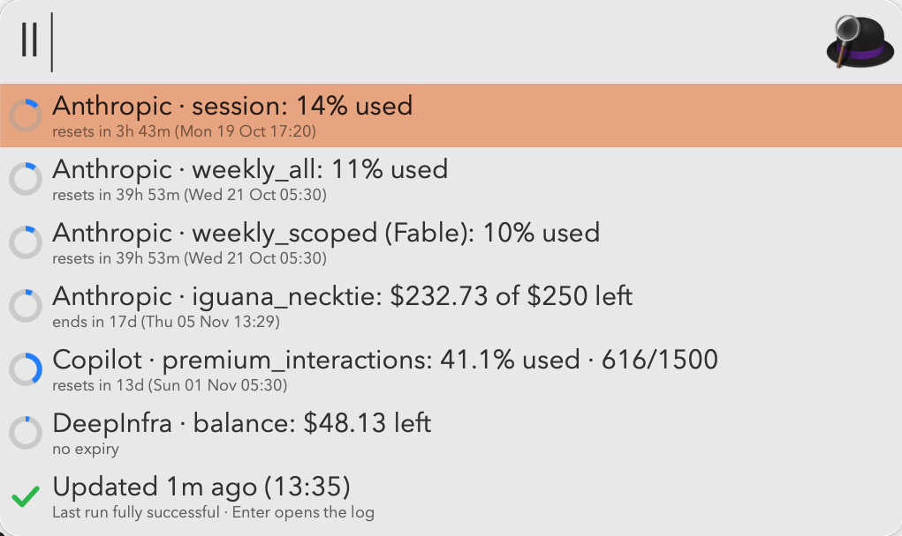

# llm-usage

Usage limits and credits for Anthropic (Claude subscription), GitHub Copilot and DeepInfra, in one JSON file and one Alfred keyword.

- `llm-usage` — Python script (stdlib only). Fetches each provider and writes `~/.cache/llm-usage.json`.
- `alfred/` — the "LLM Usage" Alfred workflow. Type `ll` to see a ring chart per limit or credit, plus when it was last updated and whether the last run succeeded.

macOS only. Uses your existing logins: Claude Code's Keychain item and `gh`. Store your DeepInfra key in the Keychain with
`security add-generic-password -a "$USER" -s DEEPINFRA_API_KEY -w` (it asks for the value). Run it every 10 minutes with a LaunchAgent; see `AGENTS.md` for the details.

## Setup

Clone the repo, open a coding agent (Claude Code, Codex, …) in it, and ask:

> Review this code for anything nasty, then set it up if it's safe.

`AGENTS.md` has the setup steps for the agent to follow.
